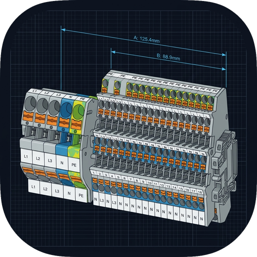

  

<h1 align="center">TermiGrid</h1>

  <strong>Configurateur de borniers &amp; exportateur d'étiquettes pour armoires électriques</strong> 
  <em>VibeCoded avec l'aide de l'IA (Google Antigravity / Gemini)</em>

  
  
  

  <a href="../README.md">🇩🇪 Deutsch</a> ·
  <a href="README.en.md">🇬🇧 English</a> ·
  🇫🇷 <strong>Français</strong> ·
  <a href="README.it.md">🇮🇹 Italiano</a> ·
  <a href="README.es.md">🇪🇸 Español</a> ·
  <a href="README.pl.md">🇵🇱 Polski</a> ·
  <a href="README.nl.md">🇳🇱 Nederlands</a>

---

## Présentation

**TermiGrid** est une application portable multiplateforme (Rust + `egui`) dédiée au câblage d'armoires électriques. Elle permet de générer des borniers (ex. `-X1`), de gérer la numérotation multi-étages (L, N, PE), d'éditer les repères directement par double-clic dans la vue CAO, de consulter les accessoires compatibles (flasques, peignes, repères, butées) et d'exporter des listes Excel (`.xlsx`) strictement formatées en Texte (`@`) pour imprimantes d'étiquettes.

> **Note :** Ce projet a été **VibeCoded** par Patrick Barbian avec l'assistance IA de **Google Antigravity / Gemini**.

### Téléchargements ([Releases](https://github.com/PatrickBarbian/TermiGrid/releases))
- **Windows (`x86_64`) :** `TermiGrid-windows-x86_64.exe` (exécutable portable autonome)
- **macOS Universal (Intel + Apple Silicon) :** `TermiGrid-macos-universal.dmg`
- **Android (Smartphones, Foldables & Tablettes) :** `TermiGrid-android-universal.apk`

### Liens & Support
- 🔗 **GitHub :** [https://github.com/PatrickBarbian/TermiGrid](https://github.com/PatrickBarbian/TermiGrid)
- ☕ **Buy Me a Coffee :** [https://buymeacoffee.com/02eOWKzm5W](https://buymeacoffee.com/02eOWKzm5W)
